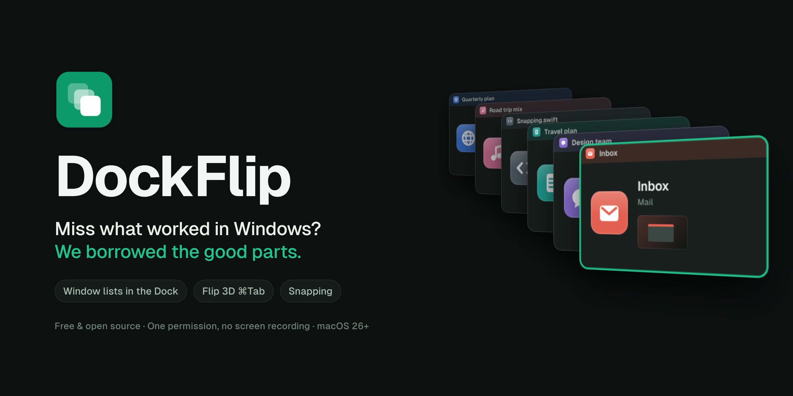
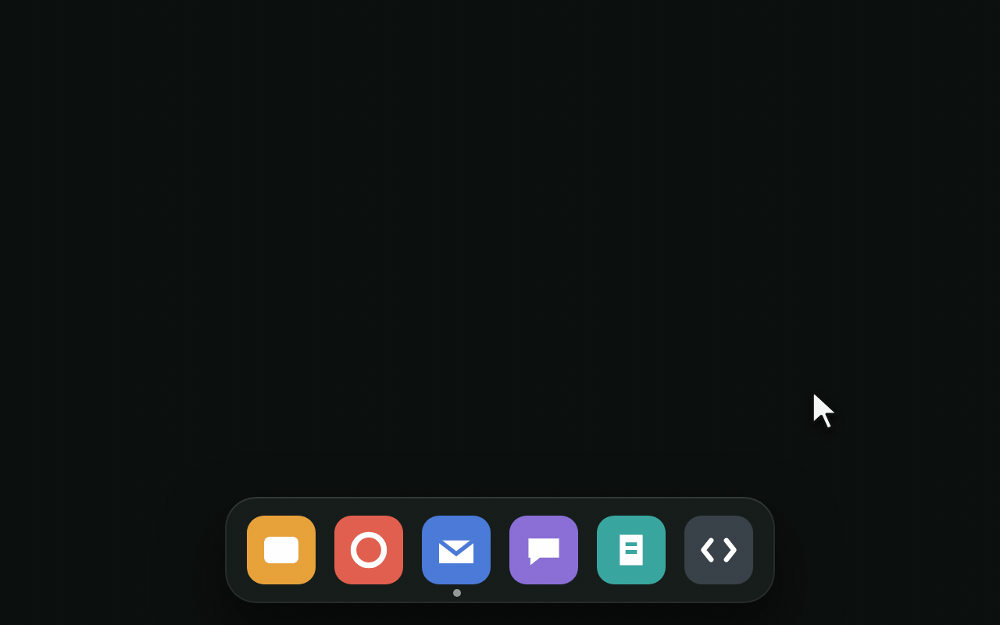
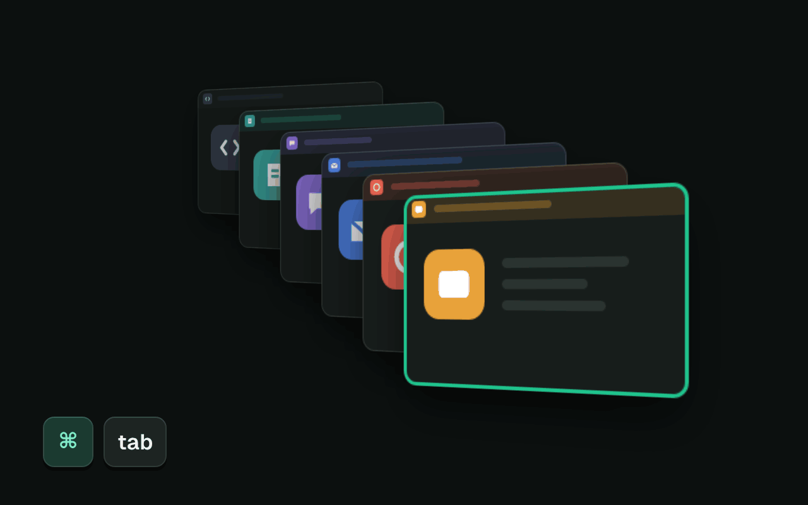
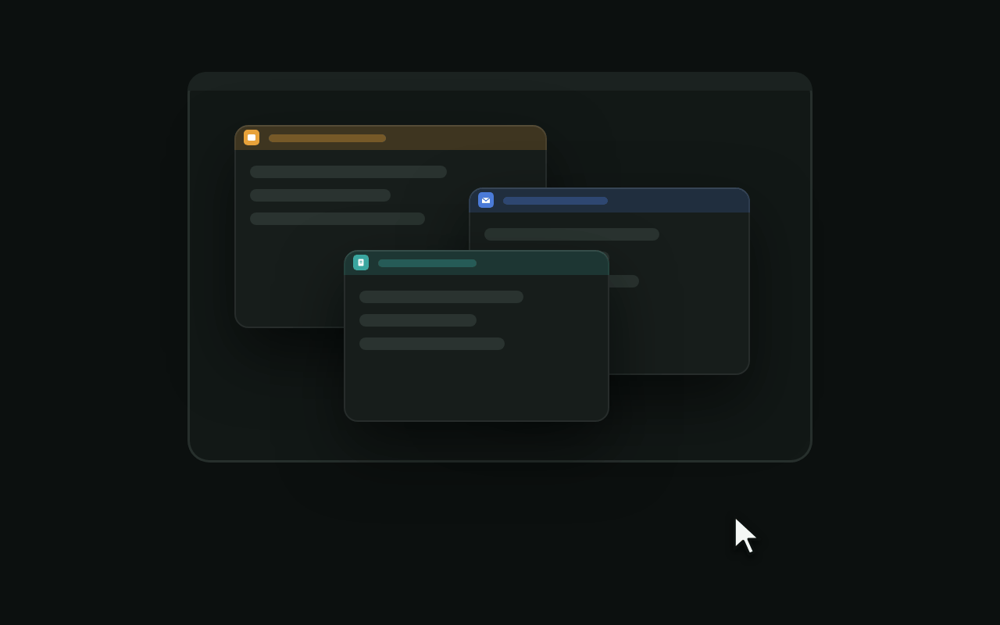
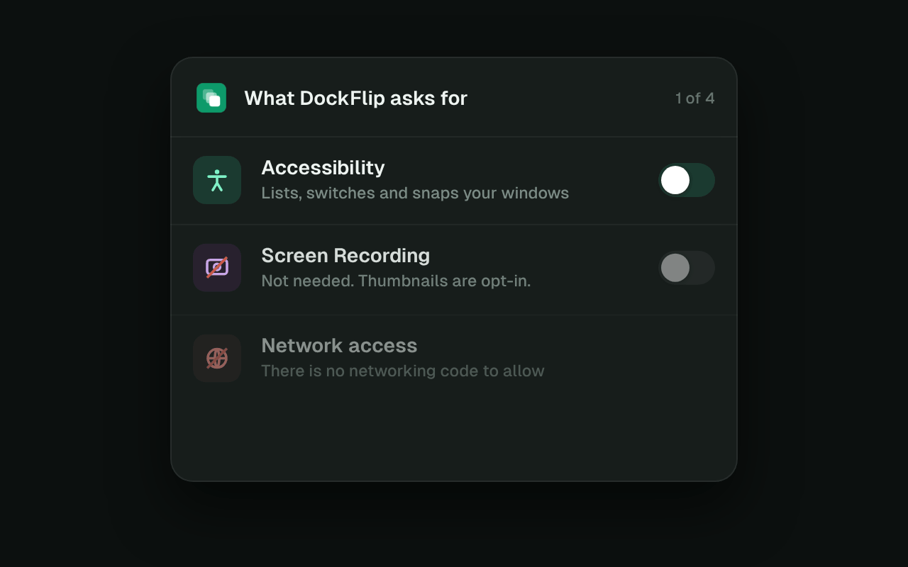

<p align="center">
  
</p>

<p align="center">
  <a href="https://github.com/geezery/DockFlip/actions/workflows/ci.yml"></a>
  
  
  <a href="LICENSE"></a>
  
  
</p>

<p align="center">
  <b>Window lists in your Dock · a Flip 3D ⌘Tab that switches <i>windows</i> · Win-style snapping</b><br>
  One small, free, open-source app. One permission, no screen recording, and it works the moment you open it.
</p>

<p align="center">
  <a href="#install">Install</a> ·
  <a href="#features">Features</a> ·
  <a href="#shortcuts">Shortcuts</a> ·
  <a href="#privacy-no-screen-recording-required">Privacy</a> ·
  <a href="https://github.com/geezery/DockFlip/wiki">Wiki</a> ·
  <a href="#faq">FAQ</a>
</p>

---

You moved to a Mac. It's lovely. Then you pressed ⌘Tab looking for that one
browser window, got *the whole browser* instead, and quietly missed Windows for
the first time.

The usual fix is three apps: one for Dock previews, one for an Alt-Tab clone,
one for window snapping. That's three settings windows, three permission
prompts and three ways for things to argue with each other.

**DockFlip is one app that does all three.** It takes the bits Windows got right
and leaves the rest where it was. No Start menu, no surprise restarts, no
paperclip.

- **Polished without peeking.** Window cards, mini-maps and tab lists look the
  part without Screen Recording. Other switchers want to see your screen;
  DockFlip only needs Accessibility.
- **Lean for real.** No polling, no timers, no dependencies, no network. When
  you're not using it, it's doing nothing at all.
- **Right out of the box.** Three settings, all with sensible defaults. You
  install it, allow one permission, and get on with your day.

## Features

### 🪟 Your Dock, now with window lists



Rest the mouse on an app in the Dock and its windows pop up in a list. Click one
to go to it, or press × to close it. The Dock itself stays exactly as it is:
folders, Trash, badges and your settings all keep working.

- **Browser tabs, listed.** Safari, Chrome, Edge, Firefox, Brave, Vivaldi and
  Opera show each window's tabs under it, and so do Finder and Terminal. Each
  site gets its own colour, duplicate tabs are marked, and a click takes you
  straight to that tab.
- **Click to minimize, click again to restore.** Clicking the app you're
  already in tucks its window away; the next click brings it back, like the
  taskbar always did.
- **Pictures, if you want them.** Thumbnails are opt-in. Without them, every
  window gets a small map of where it sits on screen, which is surprisingly
  good at telling three "Untitled" windows apart.

### 🃏 ⌘Tab, Flip 3D edition



⌘Tab now switches between **windows**, not apps, in a slanted 3D stack that
Windows 7 fans will recognise from across the room. Most recently used is in
front.

- **Every window, including the hiding ones.** Minimized windows, full-screen
  apps and windows on other desktops are all in the stack.
- **Type to filter.** Hold ⌘ and type `team`, and only the windows with "team"
  in their title or app name are left. Press Return to switch.
- **The usual keys.** Tab moves forward, ⇧ moves back, Esc cancels, and
  releasing ⌘ switches. Arrow keys and clicking work too.
- **Survives password fields.** It keeps working while another app holds
  secure keyboard input, which is exactly when lesser switchers give up.

### 📐 Snapping



**⌃⌥ is your Win key.** Use the arrows for halves, maximize and quarters, or
drag a window to an edge or a corner and let go.

### 🧹 The small stuff

- **Windows return home.** Unplug the external display and plug it back in, and
  every window goes back to where it was.
- **Clean Up.** Lists windows you haven't touched in three days and apps left
  running with no windows. It only suggests; it never closes anything without
  you, and apps still ask to save.
- **"Not responding"** shows in a hung app's window list, so you know it's the
  app and not you.
- **15 languages**, with a language menu that always says "Language" in English
  as well, in case you pick one you can't read.

## Install

<p>
  <a href="https://github.com/geezery/DockFlip/releases/latest"></a>
  <br><sub>macOS 26 or later · Apple silicon and Intel · free</sub>
</p>

1. Open the DockFlip disk image you downloaded and drag **DockFlip** to **Applications**.
2. Open DockFlip. macOS says it can't check the app for malware: press **Done**.
3. Open **System Settings → Privacy & Security**, scroll down and press
   **Open Anyway** next to DockFlip. Confirm with your password or Touch ID.
4. DockFlip's setup opens. Switch DockFlip on under **Accessibility** when it
   asks. That's it.

> Steps 2 and 3 are Apple's warning for apps whose developer doesn't pay 99 € a
> year. ☕ [A coffee](#-buy-dockflip-a-coffee) makes them go away for everyone.

**Updating:** download the new version, quit DockFlip, replace the app in
Applications and repeat steps 2–3. Your Accessibility permission stays, because
every release is signed with the same identity.

<details>
<summary><b>Build from source</b> (for developers)</summary>

You need the Command Line Tools. Xcode is optional: if you already have it,
that works too.

```sh
xcode-select --install                 # Command Line Tools, once
git clone https://github.com/geezery/DockFlip.git
cd DockFlip
make install                           # builds, signs and copies it to /Applications
```

Then allow DockFlip under **System Settings → Privacy & Security →
Accessibility**. The setup window opens the right page for you.

<details>
<summary><b>What <code>make install</code> actually does</b></summary>

1. The first time, it creates a local code-signing identity called
   "DockFlip Signing" in its own keychain
   (`~/Library/Keychains/dockflip-signing.keychain-db`). The keychain's random
   password is kept in `~/Library/Application Support/DockFlip/`. macOS asks
   for your login password once, to trust the certificate. A stable signature
   means the Accessibility permission survives rebuilds.
2. It builds `build/DockFlip.app` and signs it.
3. It copies the app to `/Applications` and starts it.

No Apple Developer account and no fees. `make uninstall` removes everything,
the certificate included.

Other targets: `make` (build only), `make run`, `make test`, `make clean`.
</details>

A source build is signed with your own local identity, not the release one, so
switching between the two means allowing Accessibility once more.
</details>

## Shortcuts

| Keys | What happens | Windows equivalent |
|---|---|---|
| ⌘ Tab | Flip 3D window switcher | Alt+Tab |
| ⌃⌥ ← / → | Left or right half; press again to move on to the next display | Win+← / → |
| ⌃⌥ ↑ | Maximize; from a half, the top quarter | Win+↑ |
| ⌃⌥ ↓ | Restore, then minimize; from a half, the bottom quarter | Win+↓ |
| ⌃⌥⇧ ← / → | Move the window to the next display | Win+Shift+← / → |
| ⌃⌥ 1…9 | Open the n-th app in the Dock | Win+1…9 |
| ⌃⌥ D | Show desktop | Win+D |
| ⌃⌥ E | New Finder window | Win+E |

All of these are also listed under **Window Layout** in DockFlip's menu bar
menu, where clicking one applies it.

## Privacy: no screen recording required



Most Dock preview apps and window switchers ask for **Screen Recording** the
moment you open them, because they're built around screenshots of your windows.
DockFlip isn't. Its window cards, mini-maps and tab lists are drawn from what
macOS already shares with it (titles, positions, icons, tabs), so it looks
polished from the first second without ever seeing your screen.

- **One permission:** Accessibility. That's the whole list.
- **No networking code.** No analytics, no crash reporter, no update check.
  DockFlip can't phone home, and nothing can phone it.
- **No third-party code.** Apple frameworks only.
- **Your typing stays yours.** DockFlip sees ordinary keys only while the ⌘Tab
  switcher is open, for type-to-filter.
- **Thumbnails are opt-in.** If you want real pictures, they're taken on demand,
  kept in memory for two minutes at most, and never taken of password managers,
  System Settings or while a password field is active.

The details, and how to check every claim yourself, are in [SECURITY.md](SECURITY.md).

## ☕ Buy DockFlip a coffee

DockFlip is free and stays free. Apple, however, charges developers 99 € a year
to let an app open without a scary "could not verify" warning. Until then,
installing takes a detour through System Settings, and so does every update.

**A coffee is $2** if you're dollar royalty, and **€2.50** if you pay in
euros, because that's what a coffee costs over here. (GitHub only takes dollars,
so euro folks just type 3 in the custom box. Keep the change.)

Every cup gets DockFlip closer to being notarized: download, drag to
Applications, open, done. Updates that simply open. If DockFlip made your day, a
bigger cup is welcome too, with good vibes and zero obligations. [**Buy DockFlip a coffee →**](https://github.com/sponsors/geezery?frequency=one-time)

No coffee? A ⭐ is free and helps the next person find DockFlip.

## FAQ

<details><summary><b>Does it replace my Dock?</b></summary>

No. Your Dock stays the real macOS Dock. DockFlip only adds the window lists and
the click behaviour on top.
</details>

<details><summary><b>Where did macOS's own ⌘Tab go?</b></summary>

DockFlip turns it off while it runs and gives it back when you quit. ⌘` still
cycles an app's windows the macOS way. If DockFlip ever crashes and your ⌘Tab
seems to be missing, start DockFlip and quit it once.
</details>

<details><summary><b>⌘Tab does nothing after I rebuilt it</b></summary>

macOS may be holding on to an Accessibility entry for an older signature. Press
**Reset Permission** in the setup window, or run
`tccutil reset Accessibility io.github.dockflip.DockFlip`, and then allow
DockFlip again.
</details>

<details><summary><b>I picked a language I can't read</b></summary>

Open the menu bar menu → 🌐 → *English*. Or run
`defaults delete io.github.dockflip.DockFlip AppleLanguages` and restart DockFlip.
</details>

<details><summary><b>Why isn't it on the Mac App Store?</b></summary>

App Store apps run in a sandbox that doesn't allow the Accessibility API, and
without that DockFlip can't see a single window.
</details>

<details><summary><b>Why ⌃⌥ and not ⌘ for snapping?</b></summary>

⌘ shortcuts belong to the app you're in, and Globe shortcuts belong to macOS's
own tiling. ⌃⌥ is the closest thing a Mac keyboard has to a free Win key.
</details>

<details><summary><b>Can you add thirds, gaps or "almost maximize"?</b></summary>

That's what Rectangle is for, and it does it very well. DockFlip sticks to the
bits Windows got right. See [SCOPE.md](SCOPE.md) for where the line is.
</details>

More in the [wiki](https://github.com/geezery/DockFlip/wiki).

## Contributing

Bug reports, translations and pull requests are welcome. Read
[CONTRIBUTING.md](CONTRIBUTING.md) first: it's short, and it explains why the
answer to "can this be a setting?" is usually "no".
[ARCHITECTURE.md](ARCHITECTURE.md) shows how everything fits together.

## Thanks

DockFlip stands on the shoulders of
[AltTab](https://github.com/lwouis/alt-tab-macos),
[DockDoor](https://github.com/ejbills/DockDoor) and
[Rectangle](https://github.com/rxhanson/Rectangle). Their authors worked out
the hard parts of macOS window wrangling and shared them. Go give them a star
too.

## License

[GPL-3.0](LICENSE). Free as in beer, and free as in you can read every line.

<p align="center"><b>Know someone who misses Windows on their Mac?</b><br>
  <a href="https://x.com/intent/post?text=DockFlip%20brings%20the%20best%20bits%20of%20Windows%20to%20the%20Mac%3A%20window%20lists%20in%20the%20Dock%2C%20a%20Flip%203D%20%E2%8C%98Tab%20that%20switches%20windows%2C%20and%20snapping.%20Free%2C%20open%20source%2C%20no%20screen%20recording.&url=https%3A%2F%2Fgithub.com%2Fgeezery%2FDockFlip">Share on X</a> ·
  <a href="https://bsky.app/intent/compose?text=DockFlip%20brings%20the%20best%20bits%20of%20Windows%20to%20the%20Mac%3A%20window%20lists%20in%20the%20Dock%2C%20a%20Flip%203D%20%E2%8C%98Tab%20that%20switches%20windows%2C%20and%20snapping.%20Free%2C%20open%20source%2C%20no%20screen%20recording.%20https%3A//github.com/geezery/DockFlip">Bluesky</a> ·
  <a href="https://www.linkedin.com/sharing/share-offsite/?url=https%3A%2F%2Fgithub.com%2Fgeezery%2FDockFlip">LinkedIn</a> ·
  or just send them <code>github.com/geezery/DockFlip</code>
</p>

<p align="center"><sub>If DockFlip cured your Alt-Tab withdrawal, a ⭐ helps the next Windows refugee find it.</sub></p>
