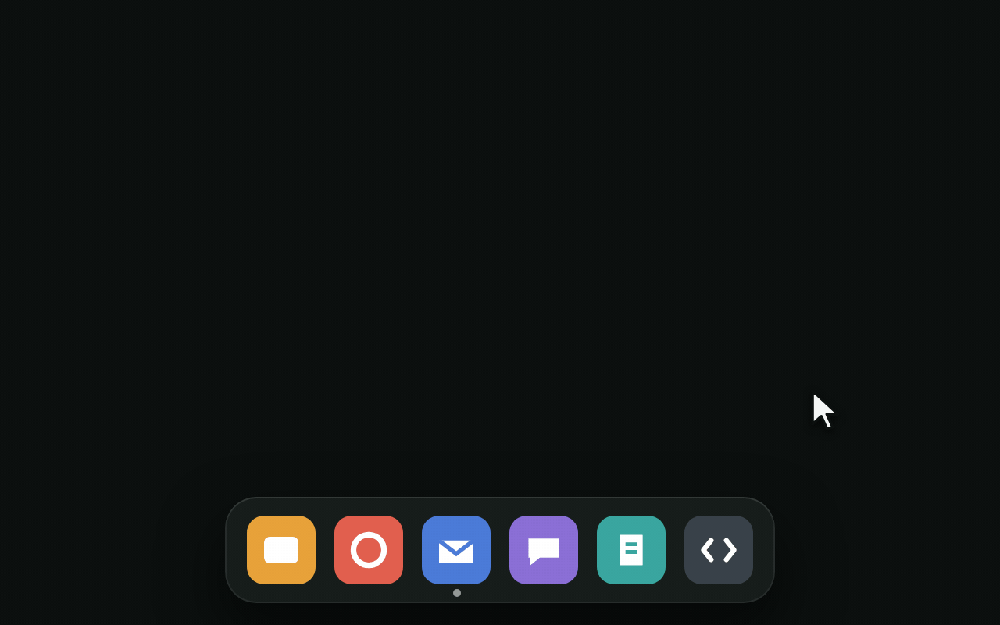
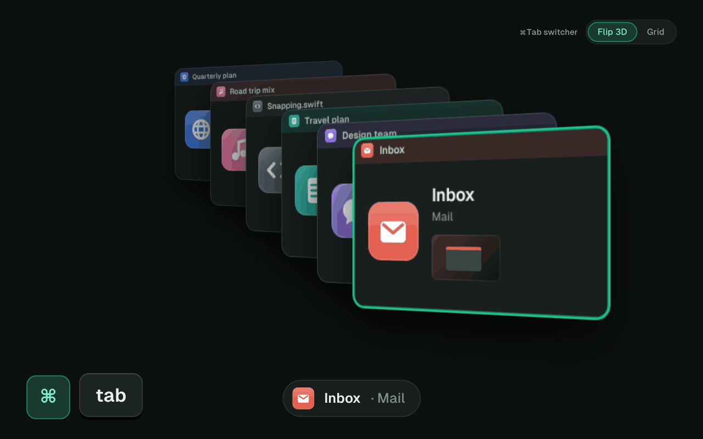
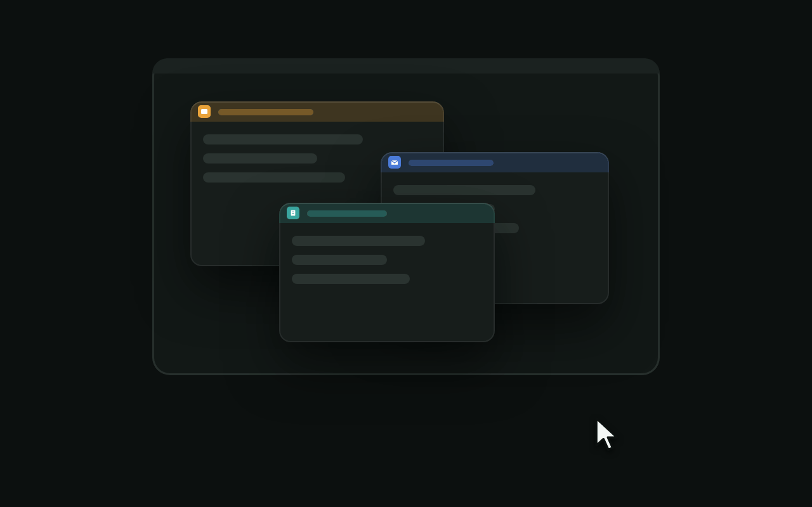

# Features

## 🪟 Window lists in the Dock

Rest the mouse on an app in the Dock, and its windows pop up in a list above it.

- **The active window is marked** with an accent bar and the words "Active
  window", so you don't have to rely on bold text alone.
- **Click a window** to go to it. **Press ×** to close it.
- **Minimized windows** and **windows on other desktops** are listed too, and
  say so.
- **Click the app you're in** to minimize its window, and click again to bring
  it back. Clicking another app brings its most recent window forward. Clicks
  with modifier keys (⌘, ⌥ and so on) go to the Dock as usual.
- **Apps without windows** get no list; the Dock does what it always does.
- **The Dock is untouched.** Folders, Trash, badges, drag and drop, magnification
  and your Dock position (bottom, left or right) all work as before.

### Browser tabs

Safari, Chrome, Edge, Firefox, Arc, Brave, Vivaldi, Opera, Zen, Orion, Chromium
and DuckDuckGo list each window's tabs under it, and so do Finder and Terminal.

- The tab you're on is marked in the app's colour.
- Each site gets its own colour chip, and the same site always gets the same colour.
- Duplicate tabs are marked "Duplicate", for the 14 tabs of the same doc we all
  have open.
- Long lists fold after eight tabs; "Show all N tabs" unfolds them and "Show fewer" folds them back.
- Click a tab to go straight to it.

Tabs are read from the browser's tab bar, never from page content.

### Thumbnails (optional)

With thumbnails on, apps with up to five windows show picture cards. Browsers
and apps with more windows keep the list, with one big picture of the window
under the mouse.
As in ⌘Tab, each picture has the app's icon at its top-left corner, over the
window's own close, minimize and zoom buttons.

## 🃏 ⌘Tab, Flip 3D edition

Hold ⌘ and press Tab: every window stands in a slanted 3D stack, with the most
recently used in front. A quick ⌘Tab (or ⌘Tab-Tab) switches without drawing the
stack at all; it appears once ⌘ is held a moment, or as soon as you type.

| Key | Action |
|---|---|
| Tab | Next window |
| ⇧ Tab | Previous window |
| ← → ↑ ↓ | Move through the stack (→ and ↓ next, ← and ↑ previous) |
| Release ⌘ | Switch to the window in front |
| Return | Switch (also while filtering) |
| Esc | Cancel, or clear the filter |
| Click | Switch to that window |

- **Type to filter.** While holding ⌘, type part of a window's title, app name
  or document name. The stack narrows as you type, and Return switches.
  Once you have let go of ⌘, Return or a click switches, even after Esc
  clears the filter; or hold ⌘ again and let go of it.
  Matching ignores case, but ä and ö count as letters of their own, so "öö"
  won't find "Outlook".
- **Every window:** minimized ones, full-screen apps and windows on other
  desktops.
- **Without thumbnails** each window is a card showing the title in a bar of the
  app's colour, the app icon, the document name, the display it's on, its size
  and a mini-map.
- **With thumbnails** the window's own close, minimize and zoom buttons are
  covered by the app's icon, because forty identical traffic lights aren't
  helping anyone.
- **Works under secure input.** Password fields and some terminal modes turn on
  macOS's secure keyboard input, which blinds most switchers. DockFlip's keeps
  working.
- **Or the Windows 11 look.** Choose *Grid* under *⌘Tab switcher* in Settings
  and ⌘Tab shows one frosted panel with a tile per window, its icon and title
  above its picture, in rows like Windows 11's Alt+Tab. The selected tile is
  outlined. The keys, the order and type to filter work just the same.
- **No windows open?** ⌘Tab then shows the running apps instead, one card each
  marked *No open windows*. Picking one brings the app forward and asks it for
  a window, as a click on its Dock icon does.

macOS's own ⌘Tab is switched off while DockFlip runs and comes back when you
quit. If another app (AltTab) already holds ⌘Tab, macOS's stays on, and the menu
and Settings say so (see [Troubleshooting](Troubleshooting)). ⌘` stays the macOS way.

## 📐 Snapping

**⌃⌥ plays the Win key.** See [[Keyboard Shortcuts]] for the full map.

- **Keyboard:** halves, maximize, restore and minimize, quarters, and moving a
  window to the next display.
- **Mouse:** drag a window to the left or right edge for a half, to the top
  edge to maximize, or near a corner for a quarter. A preview shows where it
  will land. Drag a snapped window away and it takes back its earlier size.
- **Snap Assist:** after a half or a quarter, the space left beside the window
  shows your other windows as cards. Click one, or pick it with the arrows and
  Return, and it fills that space. Esc, a click elsewhere or the next snap
  closes the cards.

## 🧹 The small stuff

- **Windows remember their place for each display setup.** Unplug the external
  display, plug it back in, and every window returns to where it was, even if
  DockFlip restarted in between. Only positions are kept, never titles, and only
  until the Mac restarts.
- **Clean Up** (menu bar → *Clean Up…*) lists windows unused for three days and
  apps running without windows. It only suggests. Nothing closes without you,
  and apps still ask to save: an app that asks comes forward with its question.
  *Keep* spares that one window until it sits unused again; its menu has *Never
  suggest this app again*, and *Kept Apps* at the bottom lists those apps to remove.
- **Not responding:** a hung app's window list says so.
- **Show desktop** with ⌃⌥D, like Win+D.
- **Window Layout** in the menu bar menu lists every shortcut; clicking one
  applies it.

## Compared with AltTab, DockDoor and macOS 27

Checked on 30 October 2026; the full table with sources is in the
[README](https://github.com/geezery/DockFlip#how-it-compares).

- **Only DockFlip** does all three jobs (Dock window lists, a window switcher
  with search, snapping) for free without Screen Recording, lists browser tabs
  under each window, and comes with an [IT kit](https://github.com/geezery/DockFlip/blob/main/docs/IT.md).
- **AltTab** switches windows; its type-to-search is in AltTab Pro.
- **DockDoor** shows Dock previews, has a switcher with search and snaps by
  title-bar swipes, and requires Screen Recording. **DockDoor Pro** ($20)
  replaces the Dock with its own.
- **macOS 27** tiles windows by itself, but its ⌘Tab still switches apps.

## What DockFlip deliberately doesn't do

- Replace the Dock. (We built our own taskbar once. The real Dock won.)
- Thirds, gaps, "almost maximize" and other Rectangle-style extras. Rectangle
  does those beautifully.
- A Start menu. Spotlight is right there.
- Settings for things that should just work.
