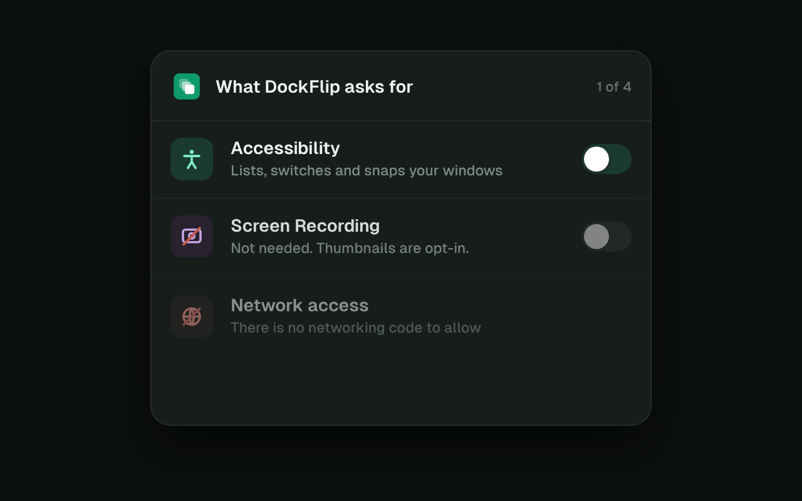

# Privacy and Permissions

DockFlip is nosy about your windows and nothing else.

## No screen recording required

Most Dock preview apps and window switchers ask for Screen Recording on first
launch, because they're built around screenshots. DockFlip draws its window
cards, mini-maps and tab lists from what macOS already shares through
Accessibility: titles, positions, icons and tabs. It looks polished from the
first second without ever seeing your screen. Thumbnails exist, but they're
opt-in.

## Permissions

| Permission | Needed? | Used for |
|---|---|---|
| Accessibility | **Yes** | Listing, focusing, moving and minimizing windows; reading browser tab titles; the keyboard shortcuts; watching left mouse clicks and drags for Dock icon clicks and drag snapping |
| Screen Recording | **No, opt-in** | Window thumbnails, and nothing else |

## What DockFlip sees of your mouse and keyboard

- **Left mouse clicks and drags, anywhere on the Mac, as pointer positions
  only.** That's how a click on a Dock icon brings its window forward and how
  dragging a window to a screen edge snaps it. Clicks and drags outside the
  Dock pass through untouched, and where you click is never recorded or logged.
  Right clicks and scrolling are never seen.
- **Pointer movement, only while it's over the Dock or a window list**, so the
  list closes when you move away.
- **Modifier keys** (⌘, ⌃, ⌥, ⇧), to notice when you press or let go of ⌘.
- **Other keys only while the ⌘Tab switcher is open**, for type-to-filter. The
  rest of the time macOS tells DockFlip only when one of its shortcuts is
  pressed.

## What DockFlip never does

- **No networking code.** None. No analytics, no crash reporter, no update
  check. There's no code that could send anything anywhere, which you can
  check with a quick search of the source.
- **No third-party code.** Apple frameworks only.
- **No window or tab titles in the debug log.** The log records timings and
  counts, not what you were looking at.
- **No page content.** Browser tabs are read from the tab bar only.
- **No titles on disk.** DockFlip's preferences hold its settings, the apps
  Clean Up keeps, when each window and app was last used, and where windows were
  for each set of displays: window numbers, bundle ids, dates and frames only.
  The window lists are dropped when the Mac restarts.

## Thumbnails, in detail

If you turn thumbnails on:

- Pictures are taken **on demand**: when you hover a Dock icon or press ⌘Tab,
  and only of windows that may look different since their last picture (ones
  you worked in, or whose title or size changed).
- They're taken **at thumbnail size**, one window at a time.
- They're kept **in memory only**: the last picture of each open window, at
  most 64, dropped when the window closes, the screen locks or the Mac sleeps.
  They're never written to disk.
- They're **never** taken while a password field is active.
- **Password managers and System Settings are never pictured.** That covers
  1Password, Bitwarden, Proton Pass, Enpass, Strongbox, NordPass, KeePassXC,
  MacPass, Secrets, Dashlane, LastPass, Authy, Apple Passwords and Keychain
  Access. Their windows show "No picture, for privacy" with a lock instead.
- **Private windows are never pictured** in Firefox, Chrome, Edge, Brave and
  Vivaldi, which end a private window's title with "Private Browsing",
  "Incognito", "InPrivate" or "Private". Safari's private windows carry no
  such mark, so they can still be pictured.

All of this lives in `Sources/DockFlipKit/Previews/PreviewProvider.swift`, with
the list of skipped apps and windows in `NeverPictured.swift` beside it, so you
can read every rule yourself.

## Check it yourself

[SECURITY.md](https://github.com/geezery/DockFlip/blob/main/SECURITY.md) shows
how to confirm there's no networking code, verify a download's build provenance
and check its signature.
